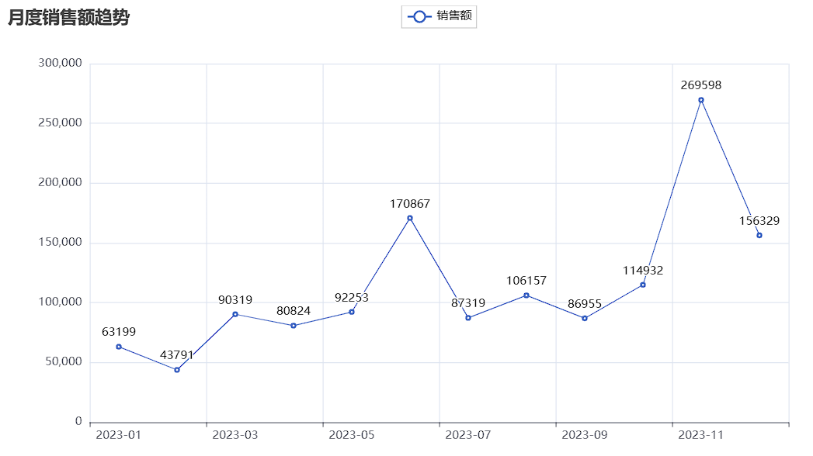
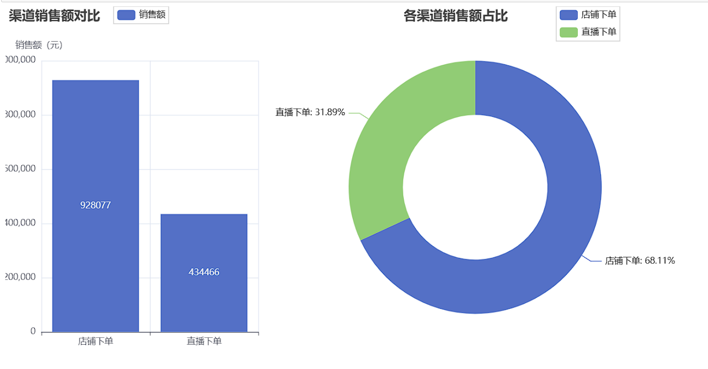
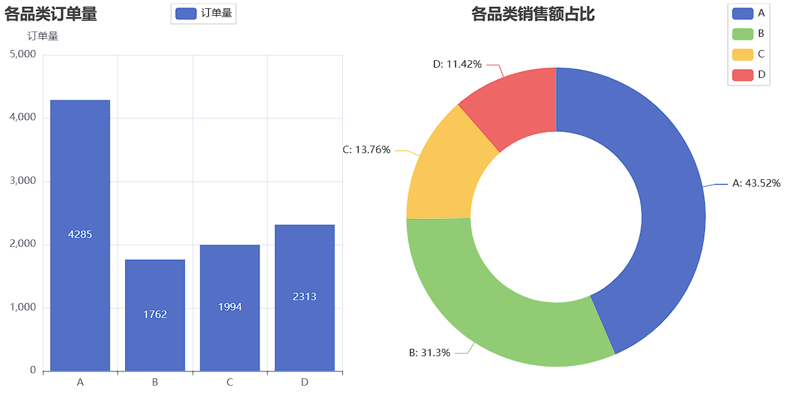
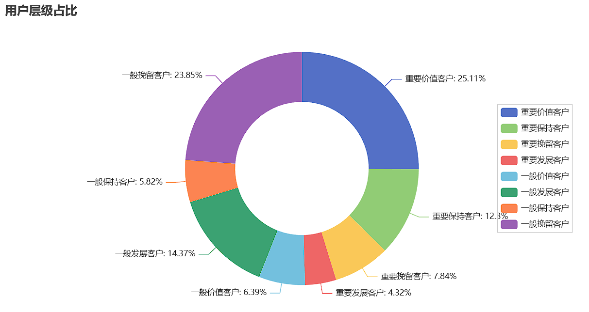

# 电商消费品牌销售经营与用户分层分析

基于某消费品牌 2023 年全年订单明细，从**销售趋势、渠道、品类、复购、会员、促销、售后**七个维度拆解经营状况，并用 **RFM 模型**做用户分层，最后通过**留出验证**检验分层的预测有效性。

- 订单量：10,354 单
- 用户数：5,137 人
- 毛销售额（GMV）：136.25 万元

---

## 数据来源

和鲸社区（Heywhale）公开脱敏数据集。订单明细粒度，覆盖 2023-01-01 至 2023-12-31，含订单交易时间、订单编号、订单来源、用户ID、会员、首次下单用户、性别、品类、商品单价、购买数量、活动优惠、换货、退货、已评价共 14 个字段。

数据为教学/练习用公开数据，本项目用于方法论验证，结论不代表真实业务判断。

---

## 快速开始

> 本项目从 MySQL 读取订单表，需先准备本地 MySQL 并导入数据。共三步，约 5 分钟。

### 1. 安装依赖

```bash
pip install -r requirements.txt
```

### 2. 配置环境变量

```bash
cp .env.example .env          # 填入自己的 MySQL 账号密码
```

```sql
-- 在 MySQL 中建库（只需一次）
CREATE DATABASE order_analysis CHARACTER SET utf8mb4;
```

### 3. 导入数据并启动

```bash
python init_db.py             # 自动建表并导入 orders_data.csv（10,354 行）
jupyter notebook
```

然后打开 notebook → `Run All`。

若环境变量缺失，第一个 cell 会直接提示缺少哪些变量，不会出现难懂的报错堆栈。

> pyecharts ≥ 2.0 若使用 JupyterLab，需在第一格加：
> `from pyecharts.globals import CurrentConfig, NotebookType; CurrentConfig.NOTEBOOK_TYPE = NotebookType.JUPYTER_LAB`

---

## 分析框架

| 模块 | 关注问题 |
|---|---|
| 经营概览 | 全年盘子多大？客单、连带处于什么水平？ |
| 月度趋势 | 增长由订单量还是客单价驱动？有无异常波动？ |
| 渠道分析 | 店铺 vs 直播，谁贡献更多、谁客单更高？ |
| 品类分析 | 哪些品类是基本盘、哪些投产比差、哪些退货高？ |
| 复购分析 | 复购人群贡献多少？渠道 × 新老客结构如何？ |
| 会员分析 | 会员 vs 非会员，客单和频次差多少？ |
| 促销分析 | 优惠单拉低客单价了吗？退货率呢？ |
| 售后分析 | 退货集中在哪个品类？ |
| RFM 分层 | 八层用户各占多少？分层有没有预测力？ |

---

## 指标口径说明

| 指标 | 定义 | 备注 |
|---|---|---|
| 销售额（GMV） | 商品单价 × 购买数量 | **毛口径，未扣退货**。全年 136.25 万元 |
| 净销售额 | 毛销售额 − 退货订单金额 | 约 126.76 万元（退货约 9.50 万元） |
| 订单量 | orders_detail 行数 | 10,354 单 |
| 用户数 | COUNT(DISTINCT 用户ID) | 5,137 人 |
| 客单价 | 销售额 ÷ **订单数** | 即单均金额，全年约 131.6 元 |
| 人均消费额 | 销售额 ÷ **去重购买人数** | 约 265.2 元，与客单价分母不同 |
| 连带率 | 销售件数 ÷ 订单量 | |
| 退货率 | 退货订单**笔数** ÷ 订单笔数 | 731 / 10,354 = **7.06%**（订单数口径） |
| 退货率（金额口径） | 退货订单金额 ÷ 总销售额 | **6.97%**，与笔数口径存在差异 |
| 换货 | 仅统计笔数 | **未做金额调整** |
| 复购用户 | 购买次数 > 1 的用户 | **用户级**标签 |
| 首单 / 非首单 | 数据集「首次下单用户」字段 | **订单级**标记 |
| R | 快照日 − 最近购买时间（天） | 快照日 = 数据内最大交易日期 + 1 |
| F | 购买次数 | 业务锚点分箱：1 / 2 / 3-4 / 5+ |
| M | 用户累计消费金额 | 毛口径 |

---

## 核心结论

**1. 全年增长由订单量驱动，客单价基本走平**
11 月销售额达全年高点 26.96 万元，环比 +134.57%，由双十一大促拉动，属正常经营波动而非异常值。销售额环比与订单量环比高度接近，客单价贡献有限。



**2. 店铺是主渠道，直播是补充**
店铺渠道 92.81 万元，占 68.11%，且客单价高于直播渠道；直播渠道 43.45 万元，占 31.88%。



**3. 品类结构分化明显**
- A 品类是基本盘：占 43.5% 销售额，退货率最低 6.25%
- B 品类是高价值品：客单价 242 元，17% 的订单贡献 31.3% 销售额，值得加投放
- C 品类退货率最高 8.68%，需优先排查
- D 品类走量不走价：22% 的订单只换来 11.4% 销售额，投产比最差



**4. 复购是生意基本盘**
2,549 名复购用户贡献 74.8% 的销售额；另外 2,588 人只买一次就流失，仅贡献 25.2%。复购用户人均件数达 3.57。

**5. 促销拉低客单价，但没有恶化退货**
优惠单占 10.6% 订单、9.51% 销售额，客单价 118.2 元（无优惠 133.2 元），但退货率反而更低（4.93% vs 7.31%）。

**6. RFM 分层经留出验证有效，但两层的资源排序要反过来看**

用上半年（1–6 月）数据打标签、检验下半年（7–12 月）的实际消费——标签期与验证期在时间上分离，避免"用 M 解释 M"的循环论证。R/F/M 的切点与分层阈值统一冻结在 H1，保证两期标签含义一致。

结果：八层下半年人均消费从 125.2 元递减到 11.1 元，约 11 倍差距，排序大体单调，分层具备预测力。

| H1 分层 | 人数（占比） | H2 人均消费 | H2 未复购率 | 优先级 |
|---|---|---|---|---|
| 重要价值客户 | 508（20.4%） | **125.2 元** | 55.5% | 高：最好的一层过半没回来，是全盘最大漏洞 |
| 重要发展客户 | 176（7.1%） | 90.5 元 | 64.2% | 高：投产比最高，近且金额高但只买 1 次 → 提频 |
| 一般发展客户 | 503（20.2%） | 70.1 元 | 69.4% | 中：盘子第二大且最近活跃，只做自动化触达 |
| 一般价值客户 | 68（2.7%） | 53.5 元 | — | 中：买得多但单价低 → 交叉销售提客单 |
| **重要保持客户** | 289（11.6%） | **30.9 元（倒挂）** | **80.6%** | 谨慎：陷阱层，先用低成本券测唤醒意愿 |
| 重要挽留客户 | 222（8.9%） | 22.5 元 | 89.6% | 低：一次性召回 + 流失原因调研 |
| 一般保持客户 | 68（2.7%） | 18.7 元 | 89.7% | 低：人数仅 2.7%，纳入常规自动化池 |
| 一般挽留客户 | 661（26.5%） | **11.1 元（垫底）** | 91.5% | 暂不投入：只保留低成本自动触达 |

两个关键发现：

- **R（近期活跃度）比 F、M 更能预测下期消费。** 唯一倒挂的是「重要保持客户」——H1 时高频高金额、极易被误判为核心，但 R 已偏低，下半年人均仅 30.9 元、80.6% 没回来，从第 2 位掉到第 5 位。同理「一般发展客户」表面是低价值层，实际人均排第 3。**没有留出验证，这两层的资源都会配反。**
- **整体留存偏弱。** H1 活跃的 2,495 人中，各层下半年未复购比例为 55.5%~91.5%；H2 共 3,249 人，两期均活跃的仅 607 人。

> 验证范围：仅覆盖 H1 活跃的 2,495 人，H2 新客无 H1 标签、不在本验证内。H2 含双十一大促而 H1 不含，验证结果偏乐观。

> 下图为**全年 5,137 人**的八层占比；上表为 **H1（上半年 2,495 人）**的分层表现与运营优先级——两个口径不同，数字不可直接互相对照。



---

## 已知局限

- **新老客存在两套口径，不可混用**：用户级看复购人群贡献（74.8%），订单级看首单收入结构（约 1:1）。
- **会员状态取用户最新一单的取值**，中途入会用户的历史订单一并归入会员组。
- **换货订单未做金额调整**，仅统计笔数。
- **数据为公开脱敏数据集**，字段有限（无地域、物流、退款金额），结论用于方法论验证，不作为真实业务判断。

---

## 项目结构

```
ecommerce-analysis/
├── ecommerce_sales_rfm_analysis.ipynb   # 主分析 notebook
├── orders_data.csv                       # 原始数据（10,354 行）
├── init_db.py                            # CSV → MySQL 一键导入
├── requirements.txt                      # 依赖清单
├── .env.example                          # 环境变量模板
├── images/                               # 关键图表（README 引用）
│   ├── monthly_trend.png                 # 月度销售额趋势
│   ├── channel_sales.png                 # 渠道销售额对比与占比
│   ├── category_sales.png                # 各品类订单量与销售额占比
│   └── rfm_user_ratio.png                # RFM 用户层级占比
└── README.md
```

## 技术栈

Python · pandas · SQLAlchemy · PyMySQL · MySQL · pyecharts · Jupyter

全流程为 SQL 取数 + pandas 计算：聚合逻辑尽量下推到 SQL（窗口函数、CTE），pandas 负责环比、分箱与可视化。
